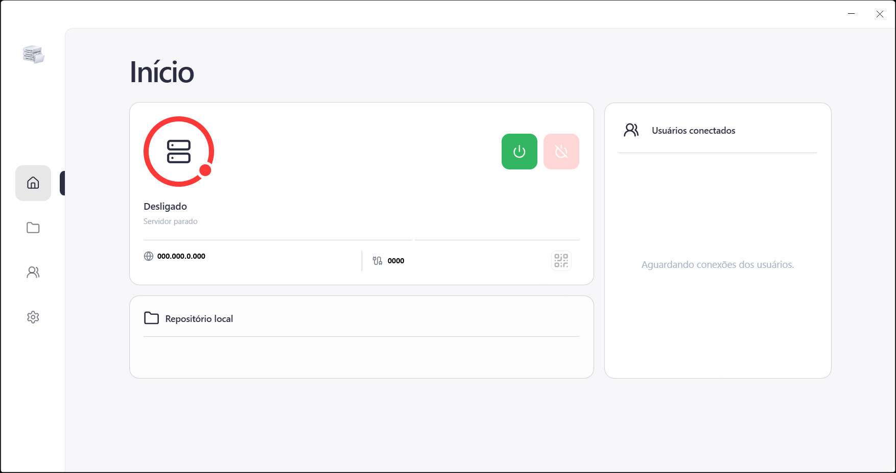

# Servidor Local de Arquivos

Aplicativo desktop para compartilhar arquivos de uma pasta do computador com
outros dispositivos na mesma rede local. A ideia é facilitar o acesso sem
precisar enviar os arquivos para um serviço externo: escolha uma pasta, ligue
o servidor e acesse pelo navegador. No celular, o QR Code mostra o endereço
para abrir sem digitar IP e porta.

## Como iniciar

Antes de começar, instale o Node.js.

1. Abra um terminal na pasta do projeto.
2. Inicie o aplicativo:

   ```bash
   npm run dev
   ```

3. Na página **Configurações**, escolha a pasta que deseja compartilhar.
4. Volte à página **Início** e pressione o botão verde para ligar o servidor.

Com o servidor ligado, clique no ícone de QR Code ao lado da porta. Conecte o
celular à mesma rede Wi-Fi do computador e escaneie o código com a câmera para
abrir o servidor no navegador. Ou se preferir digitar, use as informações de **IP** e **Porta**.

### Tela inicial



## Estrutura do projeto

- `electron/`: janela desktop e comunicação entre a interface e o sistema.
  - `splash.js`, `splash.html` e `splash.css`: tela de abertura dedicada do aplicativo.
- `server/`: servidor local, rotas e serviços de arquivos, autenticação e
  conexões.
- `src/`: interface React, organizada em páginas e módulos de componentes.
- `web/`: interface aberta no navegador dos dispositivos conectados.
  - `assets/js/app.js`: entrada do cliente web.
  - `assets/js/api/`: rotas HTTP do servidor e cliente comum para respostas JSON/texto.
  - `assets/js/features/`: autenticação e presença, gerenciador de arquivos,
    pré-visualização e transferências.
  - `assets/js/shared/`: ícones e formatação compartilhados.
- `json/`: arquivos locais de configuração do aplicativo.
- `public/`: recursos estáticos, como ícones e logotipos.

O cliente consulta `/auth/status` para saber se a senha está habilitada e
envia a senha somente quando o servidor a exige. As demais chamadas HTTP ficam
agrupadas por domínio em `web/assets/js/api/routes.js`, alinhadas às rotas de
autenticação, presença e arquivos do servidor.

## Comandos úteis

- `npm run build`: gera a versão de produção da interface.
- `npm run splash`: abre somente a tela de abertura animada para visualização.
- `npm test`: executa os testes do projeto.
- `npm run dist`: cria o instalador desktop para Windows em `release/`. A pasta
  final contém somente o arquivo de instalação; os arquivos intermediários do
  empacotamento são removidos. O instalador permite escolher a pasta de destino
  e cria atalhos na área de trabalho e no menu Iniciar.

Se a janela principal não ficar pronta em 15 segundos ou parar de responder
durante a inicialização, o aplicativo mostra um erro com as opções **Reiniciar**
e **Fechar**.

O aplicativo usa Electron, que inclui Chromium e Node.js; por isso, o tamanho
instalado tem um limite mínimo considerável mesmo quando o código do projeto é
pequeno. As dependências da interface são incorporadas à build do Vite e não
são instaladas separadamente no computador do usuário.
