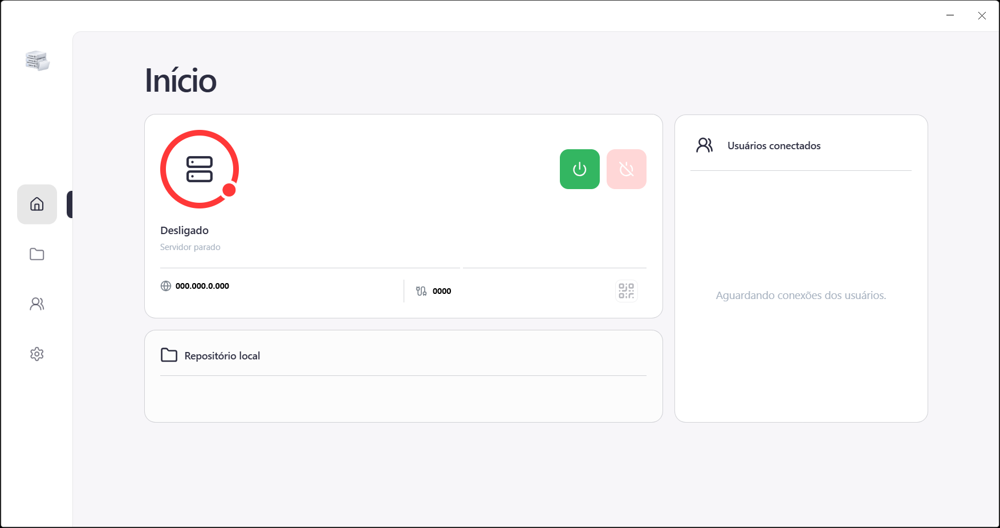

# Servidor Local de Arquivos

Aplicativo desktop para compartilhar arquivos de uma pasta do computador com
outros dispositivos na mesma rede local. A ideia é facilitar o acesso sem
precisar enviar os arquivos para um serviço externo: escolha uma pasta, ligue
o servidor e acesse pelo navegador. No celular, o QR Code mostra o endereço
para abrir sem digitar IP e porta.

## Como iniciar

Antes de começar, instale o Node.js.

1. Abra um terminal na pasta do projeto.
2. Inicie o aplicativo:

   ```bash
   npm run dev
   ```

3. Na página **Configurações**, escolha a pasta que deseja compartilhar.
4. Volte à página **Início** e pressione o botão verde para ligar o servidor.

Com o servidor ligado, clique no ícone de QR Code ao lado da porta. Conecte o
celular à mesma rede Wi-Fi do computador e escaneie o código com a câmera para
abrir o servidor no navegador. Ou se preferir digitar, use as informações de **IP** e **Porta**.

### Tela inicial



## Estrutura do projeto

- `electron/`: janela desktop e comunicação entre a interface e o sistema.
- `server/`: servidor local, rotas e serviços de arquivos, autenticação e
  conexões.
- `src/`: interface React, organizada em páginas e módulos de componentes.
- `web/`: interface aberta no navegador dos dispositivos conectados.
- `json/`: arquivos locais de configuração do aplicativo.
- `public/`: recursos estáticos, como ícones e logotipos.

## Comandos úteis

- `npm run build`: gera a versão de produção da interface.
- `npm test`: executa os testes do projeto.
- `npm run dist`: cria o instalador desktop para Windows.
